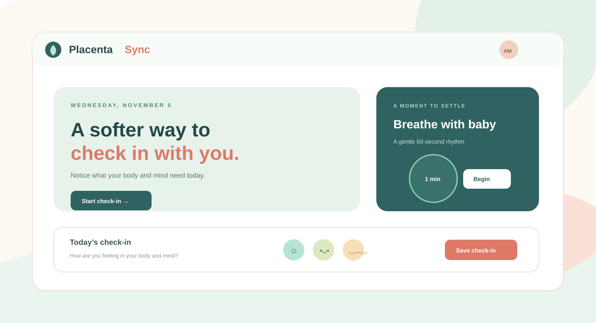
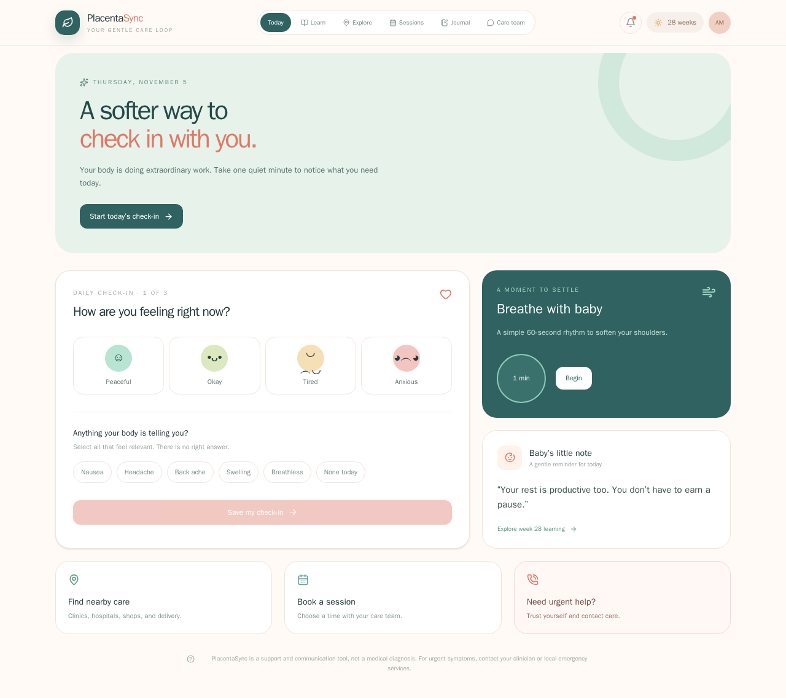
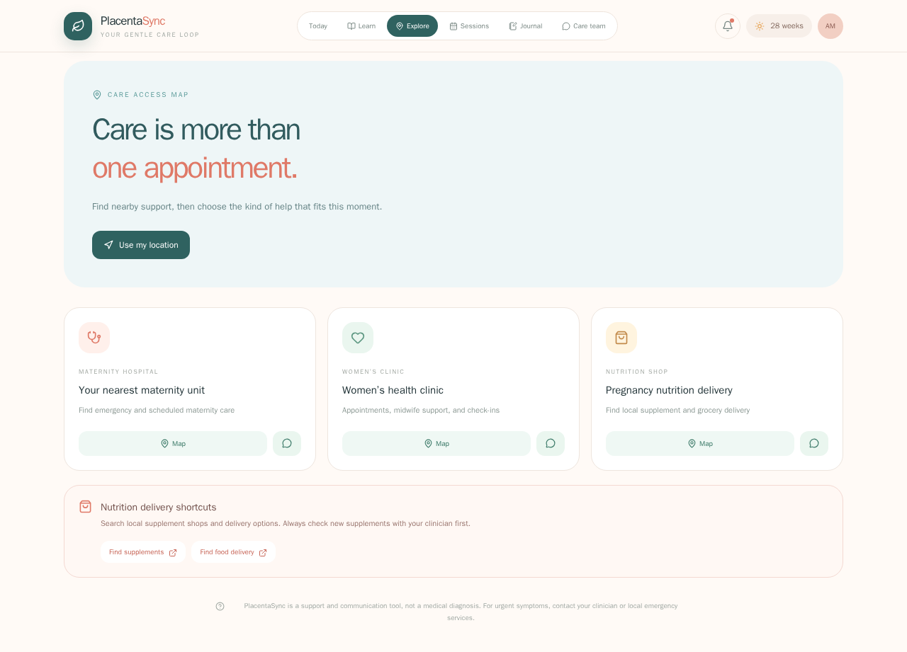
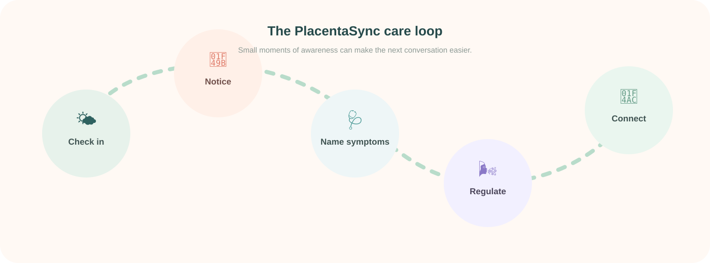
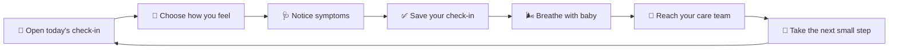

<div align="center">

# 🌿 PlacentaSync

### A softer way to check in with you. 💛

<p>
  A calm, mobile-first maternal care companion for noticing, breathing, and reaching out.
</p>

> 🌐 **Repository:** [github.com/senushidinara/PlacentaSync](https://github.com/senushidinara/PlacentaSync)
> 💬 **Care WhatsApp:** [+94 77 795 9386](https://wa.me/94777959386)

<p>
  <a href="https://github.com/senushidinara/PlacentaSync"></a>
  
  
</p>

<p>
  <a href="#-why-placentasync">Why it exists</a> ·
  <a href="#-the-care-loop">Care loop</a> ·
  <a href="#-features">Features</a> ·
  <a href="#-run-it">Run it</a> ·
  <a href="#-faq">FAQ</a>
</p>

</div>

<p align="center">
  
</p>

## 📸 See it in action

<p align="center">
  
</p>

<p align="center">
  <a href="https://6aec42d2b1ff41fd8e61c97f--earnest-speculoos-a3c583.netlify.app/">
    
  </a>
</p>

<p align="center">
  
</p>

<details>
<summary><strong>🖼️ Screenshot gallery</strong></summary>
<br>

| Screen | What to try |
| --- | --- |
| 🌤️ Today | Mood, symptom, breathing, nearby-care, booking, and urgent-help actions |
| 📚 Learn | Expand maternal education lessons and mark them as learned |
| 📍 Explore | Open nearby map searches for maternity hospitals, clinics, and nutrition shops |
| 🗓️ Sessions | Select a session, date, and time, then hand off booking/payment through WhatsApp |
| 💬 Care team | Open WhatsApp, call the care number, or save a message |

</details>

<details open>
<summary><strong>🌼 The short version</strong></summary>
<br>

PlacentaSync is a gentle daily companion for expectant parents. It makes space for a quick emotional check-in, symptom awareness, a one-minute breathing exercise, and a clear path to care-team support.

It is intentionally **not** a diagnostic dashboard. The experience is designed to feel calm, human, and useful before a clinical conversation—not to replace one.

</details>

## 🫶 Why PlacentaSync?

Pregnancy can make ordinary days feel physically and emotionally enormous. A care tool should not add more noise, more graphs, or more pressure.

PlacentaSync is built around one small question:

> **“What do I need to notice right now?”**

The interface turns that question into a simple loop:

<p align="center">
  
</p>

## ✨ Features

| Experience | What it offers |
| --- | --- |
| 🌤️ **Daily check-in** | Choose a mood and record body symptoms without judgment. |
| 🩺 **Symptom awareness** | Select what feels relevant and keep the signal easy to explain. |
| 🌬️ **Breathe with baby** | Start a calm, one-minute breathing rhythm with a visual timer. |
| 👶 **Baby’s little note** | A warm, week-aware encouragement for the day. |
| 🛡️ **Care plan** | Keep the next small actions visible and approachable. |
| 💬 **Care team** | Make support and communication easy to find. |
| ☎️ **Urgent help** | Keep escalation guidance visible when something feels wrong. |
| 📱 **Responsive UI** | Designed for phones first, then expanded for larger screens. |
| 📍 **Nearby care access** | Open map searches for maternity hospitals, women’s clinics, and nutrition shops. |
| 🥗 **Nutrition delivery** | Find nearby supplement and healthy-food delivery options with safety reminders. |
| 💬 **Direct WhatsApp** | Start a pre-filled conversation with the care team at **+94 77 795 9386**. |
| 🗓️ **Session calendar** | Choose a maternal education topic, preferred date, and time. |
| 💳 **Book & pay handoff** | Send the booking request to WhatsApp so the care team can confirm payment securely. |
| 🎥 **Video-session handoff** | Ask the care team to confirm a secure Zoom/video link after booking. |

<details>
<summary><strong>🎨 Design details</strong></summary>
<br>

- **Palette:** sage greens for calm, coral for action, warm cream for comfort.
- **Language:** supportive and direct instead of clinical or alarming.
- **Motion:** small, purposeful feedback for saving and breathing—not distracting animation.
- **Layout:** one primary action per section so the next step stays obvious.
- **Accessibility mindset:** high-contrast text, large tap targets, semantic buttons, and no interaction required to understand the page.

</details>

## 🧭 Interactive product map



<details>
<summary><strong>🔍 Click to see the user journey</strong></summary>
<br>

1. **Arrive gently** — the page opens with a warm welcome and one clear next action.
2. **Check in honestly** — select a mood, then add any body signals that feel relevant.
3. **Save a snapshot** — the check-in becomes a useful starting point for reflection.
4. **Regulate** — use the breathing card to take a quiet 60-second pause.
5. **Connect** — open care-plan, care-team, or urgent-help guidance when needed.

</details>

## 🛠️ Built with

<p>
  ⚛️ React 19 &nbsp;·&nbsp;
  🟦 TypeScript &nbsp;·&nbsp;
  ⚡ Vite &nbsp;·&nbsp;
  🎨 Tailwind CSS &nbsp;·&nbsp;
  🧩 Lucide React
</p>

This is a **standalone client-only prototype**. It does not depend on the original Embrayo project and does not require Firebase, PostgreSQL, Gemini, or an Express server.

The app is intentionally built around **safe handoffs**: maps open trusted external search, WhatsApp opens the provided care number, and payment/video details are confirmed by the care team instead of collecting card details or inventing a meeting link inside the prototype.

## 💻 Run it

<details open>
<summary><strong>Local development</strong></summary>
<br>

**Requirements:** Node.js 18+ and npm.

```bash
git clone https://github.com/senushidinara/PlacentaSync.git
cd PlacentaSync
npm install
npm run dev
```

Open the local URL printed by Vite.

</details>

<details>
<summary><strong>Production checks</strong></summary>
<br>

```bash
npm run lint
npm run build
npm run preview
```

</details>

## 🚀 Try it out

Experience the live PlacentaSync prototype here:

<p align="center">
  <a href="https://6aec42d2b1ff41fd8e61c97f--earnest-speculoos-a3c583.netlify.app/">
    <strong>🌿 Open the live PlacentaSync demo →</strong>
  </a>
</p>

> The live demo is a client-only prototype. For the best experience, open it on a phone-sized screen or in a modern mobile browser.

## 📲 Care access and booking

### One-tap WhatsApp

<a href="https://wa.me/94777959386?text=Hi%20PlacentaSync%20care%20team%2C%20I%20would%20like%20support%20with%3A%20">
  
</a>

The Care team tab includes:

- 💬 A pre-filled WhatsApp handoff to **+94 77 795 9386**
- 📞 A direct call action
- 📝 A local message composer for preparing a question
- 🔐 A clear note that urgent symptoms should not wait for messaging

### Nearby support

The Explore tab provides safe shortcuts to:

- 🏥 Maternity hospitals
- 🩺 Women’s health clinics
- 🛍️ Pregnancy nutrition and supplement shops
- 🚚 Healthy-food and supplement delivery searches

The map actions use Google Maps search rather than pretending the prototype has a verified clinic directory. Results should be checked for opening hours, distance, and maternity capability.

### Maternal education sessions

The Sessions tab lets someone:

1. Pick **Midwife check-in**, **Nutrition education**, or **Birth preparation**.
2. Select a preferred date and time.
3. Use **Book & pay via WhatsApp** to send the request to the care team.
4. Receive payment instructions and a confirmed secure video/Zoom link from the care team.

> 💳 No card details are collected in this prototype.
> 🎥 No meeting link is fabricated. The care team confirms the real payment and video details after the request.

## 🧪 Quality checklist

- [x] TypeScript validation with `npm run lint`
- [x] Production Vite build with `npm run build`
- [x] Mobile-first responsive layout
- [x] No copied Embrayo runtime dependencies
- [x] No external health-data service required for the prototype
- [x] WhatsApp and telephone actions use the provided care number
- [x] Map and delivery actions open external search safely
- [x] Booking requests include selected session, date, and time
- [x] Payment/video flow avoids collecting sensitive details in the prototype

## ⚕️ Safety and scope

<details>
<summary><strong>Read the important note</strong></summary>
<br>

PlacentaSync is a **support and communication tool**, not a medical device or diagnosis engine. It does not interpret symptoms, make treatment recommendations, or replace a clinician.

If something feels urgent or unsafe, contact your clinician, local emergency services, or the appropriate maternity assessment service immediately.

</details>

## ❓ FAQ

<details>
<summary><strong>Does PlacentaSync store my health data?</strong></summary>
<br>

The current version is a client-only prototype. It does not connect to a backend or transmit health data by itself.

</details>

<details>
<summary><strong>Can I use it on my phone?</strong></summary>
<br>

Yes. The primary layout is designed for small screens and scales up for tablets and desktop browsers.

</details>

<details>
<summary><strong>Can I customize the questions?</strong></summary>
<br>

The current prototype uses a focused set of mood and symptom options. The UI is intentionally structured so future care-plan or clinician-configured questions can be added cleanly.

</details>

<details>
<summary><strong>Where can I try PlacentaSync?</strong></summary>
<br>

The live prototype is available at the [PlacentaSync demo](https://6aec42d2b1ff41fd8e61c97f--earnest-speculoos-a3c583.netlify.app/).

</details>

## 🤝 Contributing

Ideas, accessibility feedback, and thoughtful UI improvements are welcome:

1. Fork the repository.
2. Create a focused branch.
3. Make and test your change.
4. Open a pull request with a short explanation and screenshots when useful.

## 📄 License

MIT

<div align="center">

### Made with care for calmer care conversations. 🌱

<a href="https://github.com/senushidinara/PlacentaSync">⭐ Explore the repository</a>

</div>
