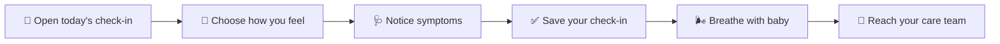

<div align="center">

# 🌿 PlacentaSync

### A softer way to check in with you. 💛

<p>
  <strong>PlacentaSync</strong> is a calm, mobile-first maternal care companion for daily check-ins,
  breathing support, care-plan prompts, and care-team communication.
</p>

<p>
  <a href="https://github.com/senushidinara/PlacentaSync">
    
  </a>
  <a href="https://app.netlify.com/start/deploy?repository=https://github.com/senushidinara/PlacentaSync">
    
  </a>
  
  
</p>

</div>

<p align="center">
  
</p>

## ✨ What it does

PlacentaSync turns a daily health moment into a gentle, structured ritual:

- 🌤️ **Daily check-in** — capture mood and body symptoms without judgment.
- 🌬️ **Breathe with baby** — start a simple one-minute breathing rhythm.
- 👶 **Baby’s little note** — receive a warm, week-aware encouragement.
- 🛡️ **Care plan** — keep the next small actions visible.
- 💬 **Care team** — create a clear path to ask for support.
- ☎️ **Urgent help** — keep emergency guidance easy to find.
- 📱 **Responsive by design** — comfortable on phones, tablets, and desktops.

> ⚕️ PlacentaSync is a support and communication tool, not a medical diagnosis. For urgent symptoms, contact a clinician or local emergency services.

## 🧭 Product flow



## 🚀 Run it locally

**Requirements:** Node.js 18+ and npm.

```bash
git clone https://github.com/senushidinara/PlacentaSync.git
cd PlacentaSync
npm install
npm run dev
```

For a production build:

```bash
npm run lint
npm run build
npm run preview
```

## 🌐 Netlify

The repository includes a ready-to-use `netlify.toml`:

| Setting | Value |
| --- | --- |
| Build command | `npm run build` |
| Publish directory | `dist` |
| SPA fallback | `/* → /index.html` |

### Deploy it in one click

<a href="https://app.netlify.com/start/deploy?repository=https://github.com/senushidinara/PlacentaSync">
  
</a>

After deployment, Netlify will provide the live URL for your site. The current repository does not yet have a verified Netlify site URL connected to it, so this README intentionally avoids publishing an unverified link.

## 🧱 Built with

⚛️ React · 🟦 TypeScript · ⚡ Vite · 🎨 Tailwind CSS · 🧩 Lucide React · 🌐 Netlify

## 🔒 Privacy-minded prototype

The current version is a client-only prototype. It does not require Firebase, PostgreSQL, Gemini, or a backend service, and it does not collect or transmit health data by itself.

## 📄 License

MIT
