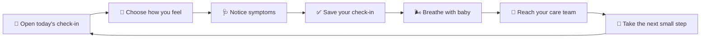

<div align="center">

# 🌿 PlacentaSync

### A softer way to check in with you. 💛

<p>
  A calm, mobile-first maternal care companion for noticing, breathing, and reaching out.
</p>

<p>
  <a href="https://github.com/senushidinara/PlacentaSync"></a>
  <a href="https://app.netlify.com/start/deploy?repository=https://github.com/senushidinara/PlacentaSync"></a>
  
  
  
</p>

<p>
  <a href="#-why-placentasync">Why it exists</a> ·
  <a href="#-the-care-loop">Care loop</a> ·
  <a href="#-features">Features</a> ·
  <a href="#-run-it">Run it</a> ·
  <a href="#-deploy-to-netlify">Deploy</a> ·
  <a href="#-faq">FAQ</a>
</p>

</div>

<p align="center">
  
</p>

<details open>
<summary><strong>🌼 The short version</strong></summary>
<br>

PlacentaSync is a gentle daily companion for expectant parents. It makes space for a quick emotional check-in, symptom awareness, a one-minute breathing exercise, and a clear path to care-team support.

It is intentionally **not** a diagnostic dashboard. The experience is designed to feel calm, human, and useful before a clinical conversation—not to replace one.

</details>

## 🫶 Why PlacentaSync?

Pregnancy can make ordinary days feel physically and emotionally enormous. A care tool should not add more noise, more graphs, or more pressure.

PlacentaSync is built around one small question:

> **“What do I need to notice right now?”**

The interface turns that question into a simple loop:

<p align="center">
  
</p>

## ✨ Features

| Experience | What it offers |
| --- | --- |
| 🌤️ **Daily check-in** | Choose a mood and record body symptoms without judgment. |
| 🩺 **Symptom awareness** | Select what feels relevant and keep the signal easy to explain. |
| 🌬️ **Breathe with baby** | Start a calm, one-minute breathing rhythm with a visual timer. |
| 👶 **Baby’s little note** | A warm, week-aware encouragement for the day. |
| 🛡️ **Care plan** | Keep the next small actions visible and approachable. |
| 💬 **Care team** | Make support and communication easy to find. |
| ☎️ **Urgent help** | Keep escalation guidance visible when something feels wrong. |
| 📱 **Responsive UI** | Designed for phones first, then expanded for larger screens. |

<details>
<summary><strong>🎨 Design details</strong></summary>
<br>

- **Palette:** sage greens for calm, coral for action, warm cream for comfort.
- **Language:** supportive and direct instead of clinical or alarming.
- **Motion:** small, purposeful feedback for saving and breathing—not distracting animation.
- **Layout:** one primary action per section so the next step stays obvious.
- **Accessibility mindset:** high-contrast text, large tap targets, semantic buttons, and no interaction required to understand the page.

</details>

## 🧭 Interactive product map



<details>
<summary><strong>🔍 Click to see the user journey</strong></summary>
<br>

1. **Arrive gently** — the page opens with a warm welcome and one clear next action.
2. **Check in honestly** — select a mood, then add any body signals that feel relevant.
3. **Save a snapshot** — the check-in becomes a useful starting point for reflection.
4. **Regulate** — use the breathing card to take a quiet 60-second pause.
5. **Connect** — open care-plan, care-team, or urgent-help guidance when needed.

</details>

## 🛠️ Built with

<p>
  ⚛️ React 19 &nbsp;·&nbsp;
  🟦 TypeScript &nbsp;·&nbsp;
  ⚡ Vite &nbsp;·&nbsp;
  🎨 Tailwind CSS &nbsp;·&nbsp;
  🧩 Lucide React &nbsp;·&nbsp;
  🌐 Netlify
</p>

This is a **standalone client-only prototype**. It does not depend on the original Embrayo project and does not require Firebase, PostgreSQL, Gemini, or an Express server.

## 💻 Run it

<details open>
<summary><strong>Local development</strong></summary>
<br>

**Requirements:** Node.js 18+ and npm.

```bash
git clone https://github.com/senushidinara/PlacentaSync.git
cd PlacentaSync
npm install
npm run dev
```

Open the local URL printed by Vite.

</details>

<details>
<summary><strong>Production checks</strong></summary>
<br>

```bash
npm run lint
npm run build
npm run preview
```

</details>

## 🌐 Deploy to Netlify

### One-click deploy

<p>
  <a href="https://app.netlify.com/start/deploy?repository=https://github.com/senushidinara/PlacentaSync">
    
  </a>
</p>

### Manual settings

The repository already includes `netlify.toml`, so Netlify can use the defaults:

| Setting | Value |
| --- | --- |
| 🔨 Build command | `npm run build` |
| 📁 Publish directory | `dist` |
| 🔁 SPA fallback | `/* → /index.html` |

> 🚀 A verified Netlify site has not been connected to this repository yet, so there is no live-app URL to publish here. Use the deploy button above and Netlify will generate the direct URL for your site.

## 🧪 Quality checklist

- [x] TypeScript validation with `npm run lint`
- [x] Production Vite build with `npm run build`
- [x] Netlify SPA redirect configured
- [x] Mobile-first responsive layout
- [x] No copied Embrayo runtime dependencies
- [x] No external health-data service required for the prototype

## ⚕️ Safety and scope

<details>
<summary><strong>Read the important note</strong></summary>
<br>

PlacentaSync is a **support and communication tool**, not a medical device or diagnosis engine. It does not interpret symptoms, make treatment recommendations, or replace a clinician.

If something feels urgent or unsafe, contact your clinician, local emergency services, or the appropriate maternity assessment service immediately.

</details>

## ❓ FAQ

<details>
<summary><strong>Does PlacentaSync store my health data?</strong></summary>
<br>

The current version is a client-only prototype. It does not connect to a backend or transmit health data by itself.

</details>

<details>
<summary><strong>Can I use it on my phone?</strong></summary>
<br>

Yes. The primary layout is designed for small screens and scales up for tablets and desktop browsers.

</details>

<details>
<summary><strong>Can I customize the questions?</strong></summary>
<br>

The current prototype uses a focused set of mood and symptom options. The UI is intentionally structured so future care-plan or clinician-configured questions can be added cleanly.

</details>

<details>
<summary><strong>Why is there no live link yet?</strong></summary>
<br>

The GitHub repository is Netlify-ready, but no verified Netlify site has been linked to it yet. Deploy it with the button above, then add the generated URL to the top of this README.

</details>

## 🤝 Contributing

Ideas, accessibility feedback, and thoughtful UI improvements are welcome:

1. Fork the repository.
2. Create a focused branch.
3. Make and test your change.
4. Open a pull request with a short explanation and screenshots when useful.

## 📄 License

MIT

<div align="center">

### Made with care for calmer care conversations. 🌱

<a href="https://github.com/senushidinara/PlacentaSync">⭐ Explore the repository</a>

</div>
