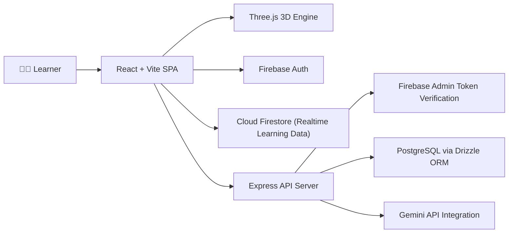
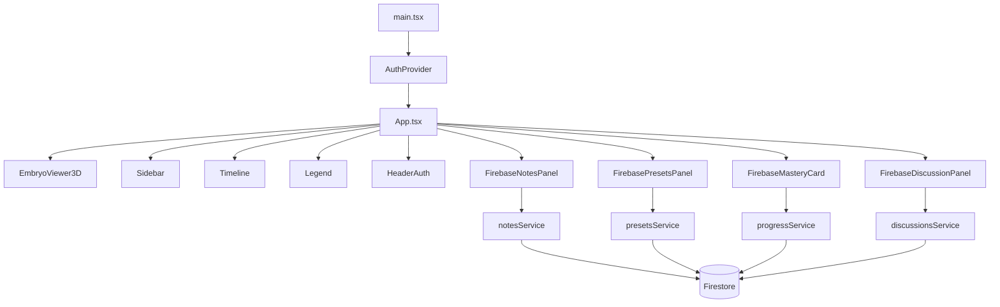
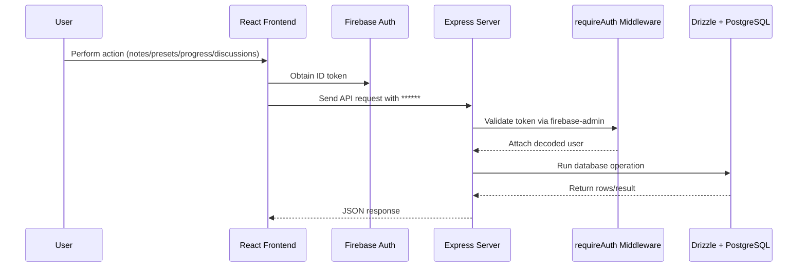

# 🧬 3D Embryo Explorer


An interactive, web-based human embryology visualizer designed to map **Weeks 1 through 4** of early human development. Built with **React**, **Three.js**, and powered by **Firebase** and **Gemini AI**, this platform bridges complex 3D developmental anatomy with intuitive learning tools.

---

## 🎬 Demo

- YouTube Shorts: https://youtube.com/shorts/3vThSdzrl0M?si=bnf3egg3PsM01F-X

---

## ✨ Features

### 🧊 3D Stage Visualization & Developmental Timeline
Explore dynamic 3D models representing pivotal early developmental milestones:
- **Day 1: The Zygote** – Fertilization, pronuclear migration, and karyogamy.
- **Day 3: The Morula** – Mitotic cleavage and compaction.
- **Day 5: The Blastocyst** – Cavitation, lineage commitment, and hatching.
- **Day 8: Bilaminar Disc** – Epiblast/Hypoblast differentiation and implantation.
- **Day 16: Gastrulation** – Primitive streak formation and establishment of the trilaminar germ layers.
- **Day 21: Neurulation** – Neural tube closure and early somitogenesis.
- **Day 28: Organogenesis & Embryonic Folding** – 3D C-shaped body curling and a functional ~160 BPM embryonic heartbeat animation.

### 🔪 Real-time 3D Cross-Section Engine
- Slice through models in real-time across customizable plane orientations: **Sagittal**, **Transverse**, or **Coronal**.
- Precise depth adjustment via interactive slider controls.

### 🔍 Germ Layer & Anatomical Inspection
- Color-coded classification tracking for key embryological structures: **Ectoderm**, **Mesoderm**, **Endoderm**, **Trophoblast**, and **Extraembryonic/Other**.
- Dynamic 3D marker flags anchored directly to model coordinates.
- **Exploded Views & Transparency Controls:** Make outer cell layers transparent or pull apart germ layers to inspect internal anatomy.

### ☁️ Cloud Sync & Study Tools
- **Lab Notes:** Write and store personal research notes synced via Firebase.
- **View Presets:** Save custom camera angles and slicing plane parameters.
- **Q&A Discussions:** Engage in peer discussion threads on anatomical topics.
- **Gemini AI Assistant:** Integrated server-side AI for interactive developmental Q&A and learning assistance.

---

## 🛠️ Tech Stack

| Domain | Technologies |
| :--- | :--- |
| **Frontend** | React 19, TypeScript, Vite, Tailwind CSS v4 |
| **3D Rendering** | Three.js (`three`), OrbitControls |
| **Icons** | Lucide React (`lucide-react`) |
| **Backend & Runtime** | Node.js, Express, `tsx`, `esbuild` |
| **Database & Auth** | Firebase (`firebase`, `firebase-admin`), PostgreSQL (`pg`, `drizzle-orm`) |
| **AI Capabilities** | Google Gen AI SDK (`@google/genai`) |

---

## 🧭 Architecture

### 1) System Landscape



### 2) Frontend Module Topology



### 3) Authenticated API Flow



---

## 🚀 Getting Started

### Prerequisites
- **Node.js** (v18+ recommended)
- **npm** or **pnpm**
- A **Firebase** project setup
- A **Google Gemini API Key**

### Installation

1. **Clone the repository:**
   ```bash
   git clone https://github.com/your-username/3d-embryo-explorer.git
   cd 3d-embryo-explorer
   ```

2. **Install dependencies:**
   ```bash
   npm install
   ```

3. **Configure Environment Variables:**
   Create a `.env` file in the root directory and populate it with your credentials:

   ```bash
   # Firebase Configuration
   VITE_FIREBASE_API_KEY=your_firebase_api_key
   VITE_FIREBASE_AUTH_DOMAIN=your_project.firebaseapp.com
   VITE_FIREBASE_PROJECT_ID=your_project_id
   VITE_FIREBASE_STORAGE_BUCKET=your_project.appspot.com
   VITE_FIREBASE_MESSAGING_SENDER_ID=your_messaging_id
   VITE_FIREBASE_APP_ID=your_app_id

   # Server & Database Configuration
   PORT=5000
   DATABASE_URL=your_database_url

   # Gemini AI Configuration
   GEMINI_API_KEY=your_gemini_api_key
   ```

4. **Run the Development Server:**
   ```bash
   npm run dev
   ```

5. Open your browser and navigate to `http://localhost:5000` (or the port specified in your Vite/Express setup).

---

## 📄 License
This project is open source and available under the MIT License.
# PlacentaSync

A gentle maternal care companion for daily check-ins, breathing support, care plans, and care-team communication.

## Run locally

```bash
npm install
npm run dev
```

## Deploy to Netlify

This repository includes `netlify.toml`. Netlify will use:

- **Build command:** `npm run build:client`
- **Publish directory:** `dist`

The SPA redirect keeps client-side routes working on refresh.

```bash
npm run build:client
```

The generated `dist/` directory can be previewed with `npm run preview`.
